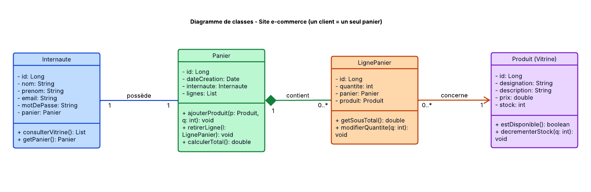
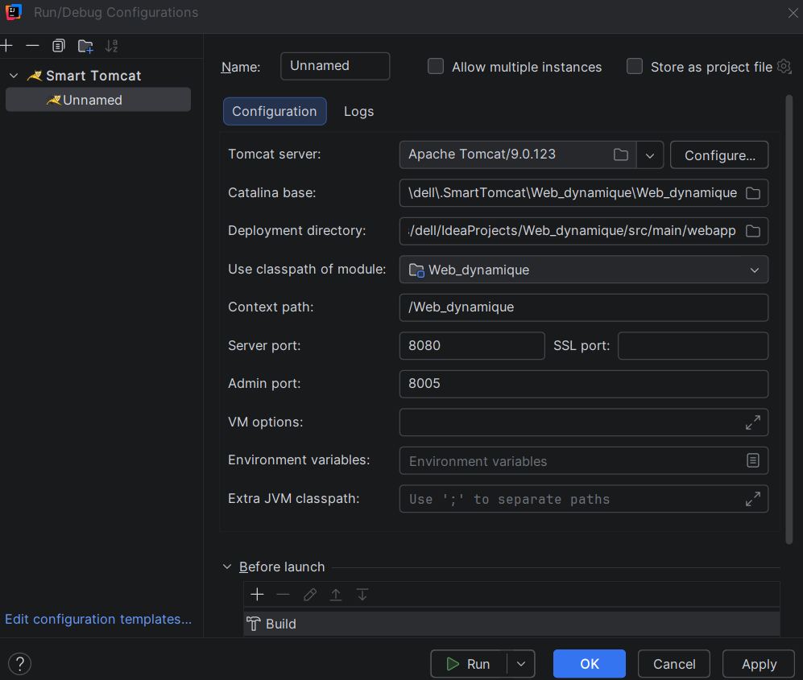
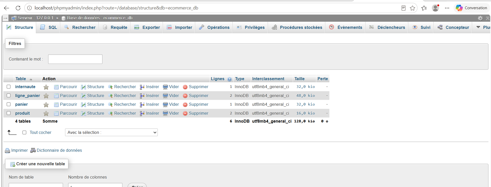
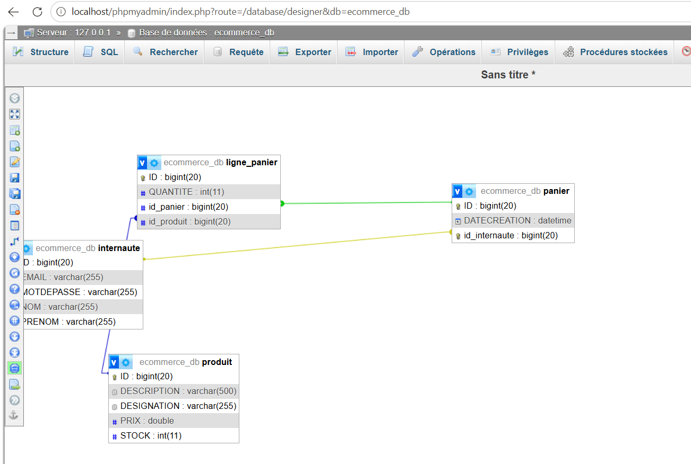
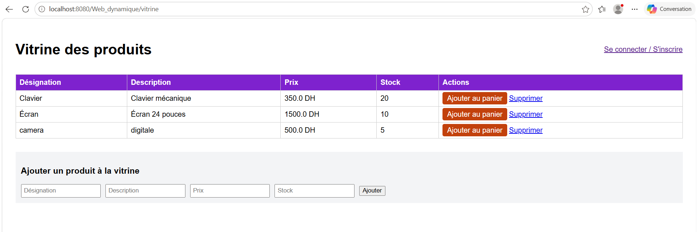
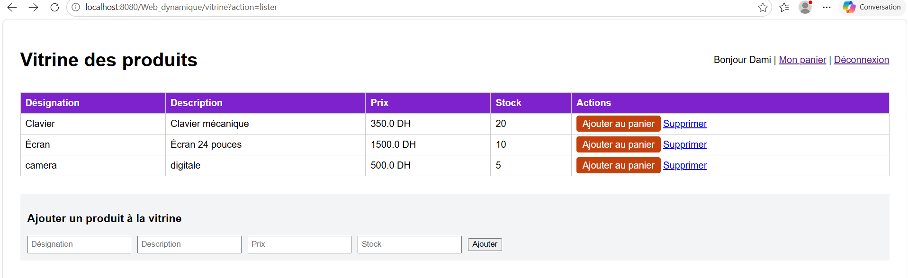
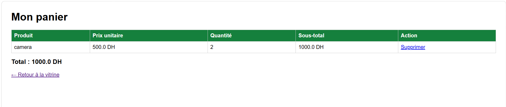

# Application web e-commerce : MVC2 et JPA

**Atelier JEE** : Université Abdelmalek Essaâdi, Faculté des Sciences et Techniques de Tanger
Département Génie Informatique, cycle ingénieur **LSI**
Encadrant : **Pr. ELAACHAK Lotfi**
Réalisé par : **DAMI Sara**

---

## Sommaire

1. [Objectif](#1-objectif)
2. [Outils et versions](#2-outils-et-versions)
3. [Architecture MVC2](#3-architecture-mvc2)
4. [Étape 1 : Diagramme de classes](#4-étape-1--diagramme-de-classes)
5. [Étape 2 : Projet Maven et dépendances](#5-étape-2--projet-maven-et-dépendances)
6. [Étape 3 : Couche modèle et persistance JPA](#6-étape-3--couche-modèle-et-persistance-jpa)
7. [Étape 4 : Contrôleurs MVC2 (une Servlet par gestion)](#7-étape-4--contrôleurs-mvc2-une-servlet-par-gestion)
8. [Les vues JSP, JSTL et jQuery](#8-les-vues-jsp-jstl-et-jquery)
9. [Structure du projet](#9-structure-du-projet)
10. [Installation et exécution](#10-installation-et-exécution)
11. [Difficultés rencontrées et solutions](#11-difficultés-rencontrées-et-solutions)
12. [Limites et perspectives](#12-limites-et-perspectives)
13. [Conclusion](#13-conclusion)

---

## 1. Objectif

Maîtriser l'API **JPA** (Java Persistence API) en développant une application web qui simule un site e-commerce. La partie contrôleur suit le patron **MVC2** : une seule Servlet par gestion, qui regroupe toutes les actions liées à cette gestion, choisies grâce au paramètre `action` de la requête.

L'application couvre trois gestions : la **vitrine** (produits), l'**internaute** (compte client) et le **panier**.

## 2. Outils et versions

| Outil | Version / détail |
|---|---|
| IDE | IntelliJ IDEA Community (avec le plugin **Smart Tomcat**) |
| JDK | 17 (Temurin) |
| Gestionnaire de build | Maven (packaging `war`) |
| Serveur d'application | Apache Tomcat **9.0.123** |
| Base de données | MySQL (XAMPP), administrée avec phpMyAdmin |
| Persistance | JPA avec **EclipseLink 2.7.14** |
| Vues | JSP, JSTL 1.2, jQuery 3.7.1 |

> Tomcat 9 correspond à l'espace de noms `javax.*` (Servlet 3.1, JPA 2.x). Tomcat 10 et plus utilisent `jakarta.*` et ne conviennent pas à ce code.

## 3. Architecture MVC2

```
 Navigateur
     │   GET /vitrine?action=lister
     ▼
┌──────────────────────────┐
│  Contrôleur (Servlet)    │  lit le paramètre "action"
│  ProduitServlet          │  appelle le DAO
│  ClientServlet           │  place les données dans la requête
│  PanierServlet           │  fait un forward vers la vue
└───────────┬──────────────┘
            │ appelle
            ▼
┌──────────────────────────┐        ┌───────────────┐
│  Modèle : DAO + entités  │───────▶│  MySQL        │
│  EntityManager (JPA)     │        │  ecommerce_db │
└──────────────────────────┘        └───────────────┘
            │ données (request.setAttribute)
            ▼
┌──────────────────────────┐
│  Vue : JSP + JSTL        │  affiche uniquement, sans logique métier
└──────────────────────────┘
```

Les JSP sont placées dans `WEB-INF/vues/` : le navigateur ne peut pas les appeler directement, il passe forcément par une Servlet.

---

## 4. Étape 1 : Diagramme de classes

Le diagramme se concentre sur la gestion du **panier**, de la **vitrine** et de l'**internaute**. Il a été réalisé avec Lucidchart.



**Choix de conception**

- **`LignePanier` est une classe associative.** On ne peut pas relier directement `Panier` et `Produit` sans perdre la quantité commandée (par exemple 2 claviers, 1 écran).
- **Un internaute possède un seul panier** (`1` vers `1`), créé dès l'inscription.
- **Composition entre `Panier` et `LignePanier`** : une ligne n'existe pas sans son panier. Un panier peut être vide (`0..*` lignes).
- **`LignePanier` vers `Produit`** : chaque ligne référence un seul produit, qui peut apparaître dans plusieurs lignes.

| Relation | Cardinalités |
|---|---|
| Internaute – Panier | 1 – 1 |
| Panier – LignePanier | 1 – 0..* (composition) |
| LignePanier – Produit | 0..* – 1 |

---

## 5. Étape 2 : Projet Maven et dépendances

Le projet est une application web (`packaging war`) créée à partir de l'archétype `maven-archetype-webapp`, puis configurée dans le `pom.xml`.

```xml
<dependencies>
    <!-- Pilote JDBC MySQL -->
    <dependency>
        <groupId>mysql</groupId>
        <artifactId>mysql-connector-java</artifactId>
        <version>8.0.12</version>
    </dependency>

    <!-- JPA + fournisseur EclipseLink (inclut javax.persistence) -->
    <dependency>
        <groupId>org.eclipse.persistence</groupId>
        <artifactId>eclipselink</artifactId>
        <version>2.7.14</version>
    </dependency>

    <!-- JSTL pour les JSP -->
    <dependency>
        <groupId>javax.servlet</groupId>
        <artifactId>jstl</artifactId>
        <version>1.2</version>
    </dependency>

    <!-- API Servlet fournie par Tomcat (non embarquée dans le .war) -->
    <dependency>
        <groupId>javax.servlet</groupId>
        <artifactId>javax.servlet-api</artifactId>
        <version>3.1.0</version>
        <scope>provided</scope>
    </dependency>
</dependencies>
```

| Dépendance | Rôle |
|---|---|
| `mysql-connector-java` | Pilote de communication entre Java et MySQL |
| `eclipselink` | Fournisseur JPA : lit les annotations et génère le SQL. Il apporte aussi l'API `javax.persistence` |
| `javax.servlet-api` (`provided`) | Pour écrire les Servlets. Fournie par Tomcat à l'exécution |
| `jstl` | Balises `<c:forEach>`, `<c:if>`… pour les JSP |

Le fichier `web.xml` est en version **Servlet 3.1** : l'archétype le génère dans une version très ancienne qui désactiverait les expressions EL (`${...}`) dans les JSP.

**Configuration de Tomcat dans IntelliJ (Smart Tomcat)**




## 6. Étape 3 : Couche modèle et persistance JPA

### 6.1 Les entités (`ma.fstt.ecommerce.model`)

| Entité | Table | Rôle |
|---|---|---|
| `Produit` | `produit` | Article de la vitrine : `id`, `designation`, `description`, `prix`, `stock` |
| `Internaute` | `internaute` | Client : `id`, `nom`, `prenom`, `email` (unique), `motDePasse` |
| `Panier` | `panier` | Panier d'un internaute : `id`, `dateCreation` |
| `LignePanier` | `ligne_panier` | Un produit dans un panier avec sa `quantite` |

Chaque entité possède un **constructeur sans argument** et des **getters/setters publics**, obligatoires pour JPA.

**Les relations**

```java
// Panier.java : côté propriétaire de la relation 1-1 (porte la clé étrangère id_internaute)
@OneToOne
@JoinColumn(name = "id_internaute", unique = true, nullable = false)
private Internaute internaute;

// Panier.java : composition, les lignes vivent et meurent avec le panier
@OneToMany(mappedBy = "panier", cascade = CascadeType.ALL, orphanRemoval = true)
private List<LignePanier> lignes = new ArrayList<>();

// LignePanier.java : côté "plusieurs", crée les clés étrangères physiques
@ManyToOne
@JoinColumn(name = "id_panier")
private Panier panier;

@ManyToOne
@JoinColumn(name = "id_produit", nullable = false)
private Produit produit;

// Internaute.java : côté inverse (la clé est dans la table panier)
@OneToOne(mappedBy = "internaute", cascade = CascadeType.ALL)
private Panier panier;
```

- `@ManyToOne` + `@JoinColumn` crée la clé étrangère dans la base.
- `mappedBy` indique le côté qui **ne porte pas** la clé.
- `cascade = ALL` + `orphanRemoval = true` : enregistrer ou supprimer un panier fait de même avec ses lignes.
- `@GeneratedValue(strategy = GenerationType.IDENTITY)` active l'auto-incrément MySQL.

### 6.2 Le fichier `persistence.xml`

Emplacement imposé par le standard : `src/main/resources/META-INF/persistence.xml`.

```xml
<persistence-unit name="eCommercePU" transaction-type="RESOURCE_LOCAL">
    <provider>org.eclipse.persistence.jpa.PersistenceProvider</provider>

    <class>ma.fstt.ecommerce.model.Produit</class>
    <class>ma.fstt.ecommerce.model.Internaute</class>
    <class>ma.fstt.ecommerce.model.Panier</class>
    <class>ma.fstt.ecommerce.model.LignePanier</class>

    <properties>
        <property name="javax.persistence.jdbc.driver" value="com.mysql.cj.jdbc.Driver"/>
        <property name="javax.persistence.jdbc.url"
                  value="jdbc:mysql://localhost:3306/ecommerce_db?createDatabaseIfNotExist=true&amp;serverTimezone=UTC"/>
        <property name="javax.persistence.jdbc.user" value="root"/>
        <property name="javax.persistence.jdbc.password" value=""/>

        <property name="eclipselink.ddl-generation" value="create-or-extend-tables"/>
        <property name="eclipselink.logging.level" value="FINE"/>
    </properties>
</persistence-unit>
```

- `eclipselink.ddl-generation = create-or-extend-tables` : les tables sont créées automatiquement au premier accès, et les colonnes ajoutées plus tard sont prises en compte.
- `createDatabaseIfNotExist=true` : EclipseLink crée les tables mais pas la base elle-même, cette option la crée au besoin.

### 6.3 La classe `JPAUtil`

L'`EntityManagerFactory` est une ressource lourde et partageable : elle est créée **une seule fois** dans un bloc `static`. L'`EntityManager`, léger mais non partageable, est fourni à neuf pour chaque opération.

```java
public class JPAUtil {
    private static final EntityManagerFactory emf =
            Persistence.createEntityManagerFactory("eCommercePU");

    public static EntityManager getEntityManager() { return emf.createEntityManager(); }
    public static void close() { if (emf.isOpen()) emf.close(); }
}
```

### 6.4 La couche DAO (`ma.fstt.ecommerce.dao`)

Un `GenericDAO<T>` contient le code commun, chaque DAO concret en hérite :

| Méthode | Opération JPA |
|---|---|
| `save(entity)` | transaction + `em.persist()` |
| `update(entity)` | transaction + `em.merge()` |
| `delete(id)` | transaction + `em.remove()` |
| `findById(id)` | `em.find()` |
| `findAll()` | requête JPQL `SELECT e FROM <Entité> e` |

Chaque écriture suit le schéma `begin()` → opération → `commit()`, avec `rollback()` en cas d'erreur. Les requêtes spécifiques sont placées dans les DAO concrets :

- `InternauteDAO.findByEmail(email)`
- `PanierDAO.findLignes(idInternaute)`
- `PanierDAO.ajouterProduit(idInternaute, idProduit, quantite)` : incrémente la quantité si le produit est déjà dans le panier, sinon crée une nouvelle ligne
- `PanierDAO.supprimerLigne(idLigne, idInternaute)` : vérifie que la ligne appartient bien au panier de l'internaute connecté

### 6.5 Validation : base de données générée

Un programme de test (`TestJPA`) enregistre des produits, un internaute et un panier avec deux lignes. Les quatre tables ont été créées automatiquement par EclipseLink.



Le concepteur de phpMyAdmin montre les clés étrangères correspondant aux relations du diagramme : `ligne_panier` vers `panier` et vers `produit`, et `panier` vers `internaute`.



---

## 7. Étape 4 : Contrôleurs MVC2 (une Servlet par gestion)

Conformément à l'énoncé, chaque gestion a **une seule Servlet** qui aiguille plusieurs actions selon le paramètre `action` :

```java
String action = request.getParameter("action");
if (action == null) action = "lister";

if ("ajouter".equals(action)) {
    // action 1
} else if ("supprimer".equals(action)) {
    // action 2
} else {
    // action par défaut
}
```

| Gestion | Servlet | URL | Actions |
|---|---|---|---|
| Vitrine | `ProduitServlet` | `/vitrine` | `lister` (défaut), `ajouter`, `supprimer` |
| Internaute | `ClientServlet` | `/client` | `connexion` (défaut), `connecter`, `inscrire`, `deconnecter` |
| Panier | `PanierServlet` | `/panier` | `afficher` (défaut), `ajouter`, `supprimer` |

**Points importants**

- **Patron Post/Redirect/Get** : après une écriture (ajout, suppression), la Servlet fait un `sendRedirect`. Actualiser la page ne refait donc pas l'action.
- **Session HTTP** : à la connexion, l'internaute est stocké dans la session. La `PanierServlet` renvoie vers `/client` si personne n'est connecté.
- **Suppression d'un produit** : si le produit figure déjà dans un panier, MySQL refuse la suppression (clé étrangère). La Servlet attrape l'erreur et affiche un message.
- **Liaison modèle-contrôleur** : chaque Servlet crée son DAO dans `init()` et l'utilise pour accéder au modèle.
- **Panier** : l'action `ajouter` incrémente la quantité d'une ligne existante au lieu de créer un doublon.

---

## 8. Les vues JSP, JSTL et jQuery

Les JSP ne contiennent **aucune logique métier ni requête** : elles affichent ce que la Servlet leur transmet. Elles utilisent la bibliothèque **JSTL** (`<c:forEach>`, `<c:if>`, `<c:choose>`, `<c:set>`, `<c:out>`).

| Vue | Rôle |
|---|---|
| `vitrine.jsp` | Catalogue des produits, lien « Ajouter au panier », formulaire d'ajout de produit |
| `panier.jsp` | Lignes du panier, sous-totaux, total calculé avec `<c:set>`, lien de suppression |
| `connexion.jsp` | Formulaires de connexion et d'inscription |
| `index.jsp` | Point d'entrée : redirige vers `/vitrine` |

**jQuery** : un clic sur « Ajouter au panier » déclenche une animation (la ligne clignote, le bouton devient « Ajouté ✓ ») avant l'ajout effectif.

### Captures de l'application

**Vitrine (visiteur non connecté)**



**Vitrine (internaute connecté)** : le menu affiche le prénom, le lien « Mon panier » et « Déconnexion ».



**Panier** : chaque ligne affiche le produit, le prix unitaire, la quantité et le sous-total, puis le total du panier.



---

## 9. Structure du projet

```
Web_dynamique/
├── pom.xml
└── src/main/
    ├── java/ma/fstt/ecommerce/
    │   ├── model/          Produit, Internaute, Panier, LignePanier
    │   ├── dao/            GenericDAO, ProduitDAO, InternauteDAO, PanierDAO, LignePanierDAO
    │   ├── controller/     ProduitServlet, ClientServlet, PanierServlet
    │   ├── util/           JPAUtil
    │   └── test/           TestJPA
    ├── resources/META-INF/
    │   └── persistence.xml
    └── webapp/
        ├── index.jsp
        └── WEB-INF/
            ├── web.xml
            └── vues/       vitrine.jsp, panier.jsp, connexion.jsp
```

---

## 10. Installation et exécution

**Prérequis** : JDK 17, Maven, Tomcat 9, XAMPP (MySQL), IntelliJ IDEA avec le plugin Smart Tomcat.

1. **Cloner le dépôt**
   ```bash
   git clone <URL-du-depot>
   ```
2. **Démarrer MySQL** depuis le panneau de contrôle XAMPP (utilisateur `root`, mot de passe vide, port 3306). Si besoin, adapter `persistence.xml`.
3. **Ouvrir le projet** dans IntelliJ IDEA, puis recharger Maven (icône **Load Maven Changes**).
4. **Configurer Tomcat** : *Run → Edit Configurations → + → Smart Tomcat*
   - Tomcat Server : Tomcat 9
   - Deployment directory : `src/main/webapp`
   - Context path : `/Web_dynamique`
   - Port : `8080`
5. **Lancer** avec le bouton *Run*, puis ouvrir `http://localhost:8080/Web_dynamique/`.

La base `ecommerce_db` et ses tables sont créées automatiquement au premier accès à la base. Pour avoir des produits dès le départ, ajouter des produits depuis la vitrine ou lancer `TestJPA` une seule fois.

---

## 11. Difficultés rencontrées et solutions

| Problème | Cause | Solution |
|---|---|---|
| Pas de template « Jakarta EE » dans IntelliJ | Édition **Community** : le template et l'intégration Tomcat sont réservés à Ultimate | Archétype Maven `maven-archetype-webapp` + plugin **Smart Tomcat** |
| Conflit `javax` / `jakarta` | Jakarta EE 9+ a renommé les paquets | Tomcat 9 et dépendances en `javax` |
| `web.xml` généré en version ancienne | L'archétype produit un descripteur Servlet 2.3 qui désactive l'EL | Remplacé par un `web.xml` en version 3.1 |
| `cannot find symbol class ProduitDAO` | Les fichiers DAO avaient été créés hors du dossier `dao`, alors que leur `package` indiquait `dao` | Déplacement des fichiers dans le bon package (`F6`, *Refactor → Move*) |
| Page « Hello World » inchangée après les tests | Le bouton *Run* était lié à la configuration Tomcat, pas à `TestJPA` | Exécution séparée de `TestJPA.main()` pour créer les tables |
| Base de données inexistante | EclipseLink crée les tables, pas la base | Option `createDatabaseIfNotExist=true` dans l'URL JDBC |
| `javax.persistence 2.0.0` indiquée dans l'énoncé avec EclipseLink 2.7 | Risque de conflit de versions | EclipseLink 2.7.14 seul, qui apporte son API JPA |

---

## 12. Limites et perspectives

- **Mots de passe en clair** : à remplacer par un hachage (BCrypt) dans un vrai projet.
- **Stock** : il n'est ni vérifié à l'ajout au panier, ni décrémenté. Une évolution serait de bloquer l'ajout au-delà du stock disponible, et de décrémenter le stock seulement à la **validation d'une commande**.
- **Validation de commande** : le panier n'est pas encore transformé en commande (entités `Commande` et `LigneCommande`, paiement).
- **Modification de produit** : la vitrine permet d'ajouter et de supprimer, mais pas de modifier.
- **Injection de dépendances** : les DAO sont instanciés dans `init()` des Servlets. On pourrait utiliser CDI ou un conteneur d'injection.
- **Droits** : tout internaute connecté peut ajouter ou supprimer un produit. Un rôle administrateur serait à prévoir.
- **Gestion de l'`EntityManagerFactory`** : elle n'est jamais fermée à l'arrêt de l'application. Un `ServletContextListener` pourrait appeler `JPAUtil.close()`.

## 13. Conclusion

L'atelier a permis de mettre en place une application web complète suivant le patron **MVC2** : un modèle persistant avec **JPA/EclipseLink** (génération automatique de la base MySQL), trois Servlets où chaque gestion regroupe ses actions, et des vues JSP en **JSTL**. L'application permet de consulter la vitrine, de gérer un compte client et de remplir un panier dont les totaux sont calculés.

## Références

- Énoncé de l'atelier : *Application web basée sur MVC2 et JPA*, Pr. ELAACHAK Lotfi, FST Tanger

